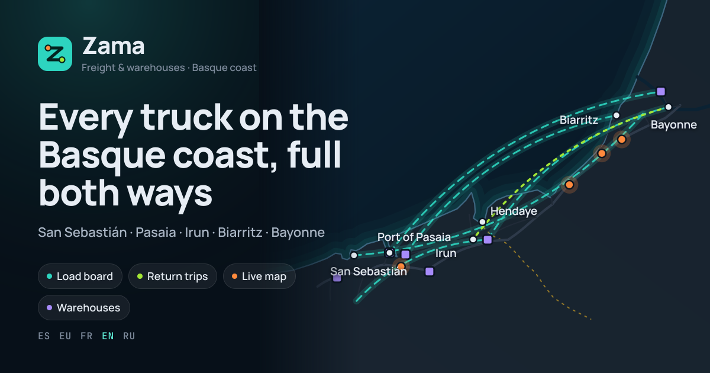
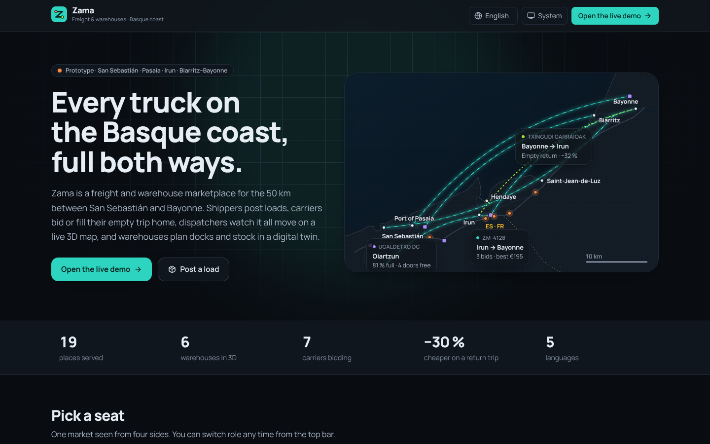
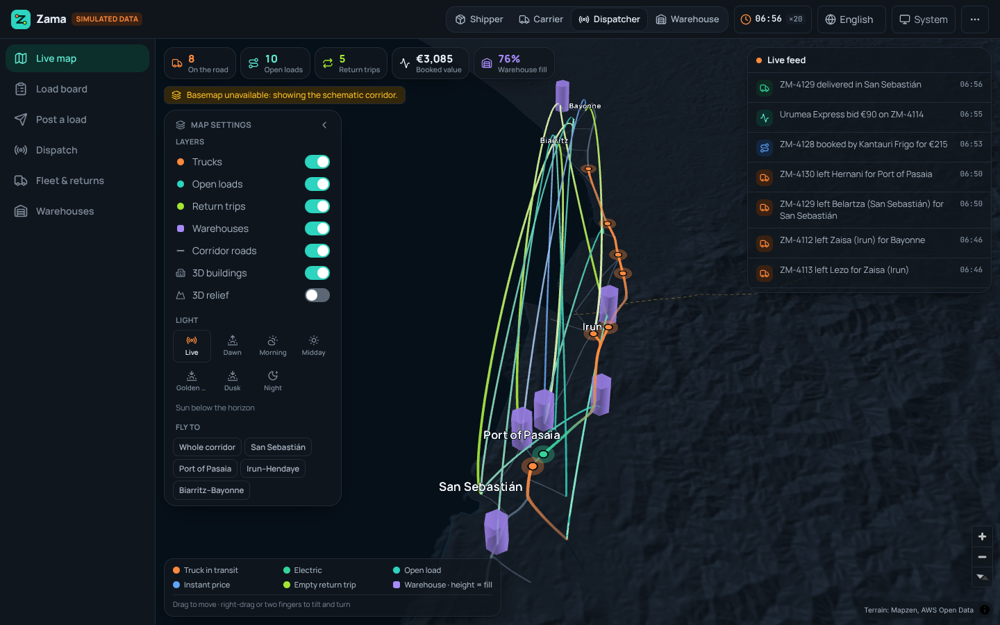
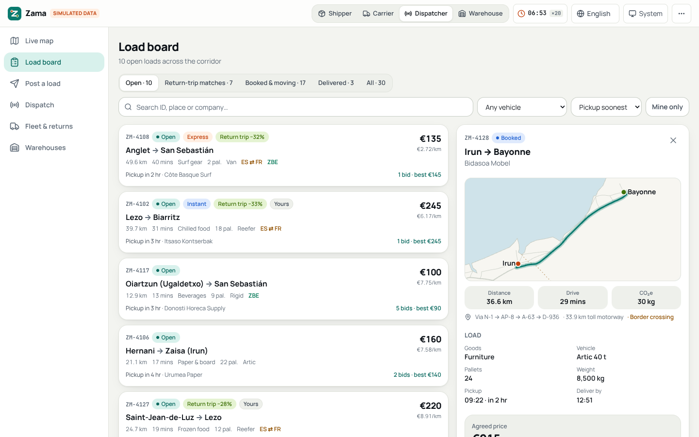
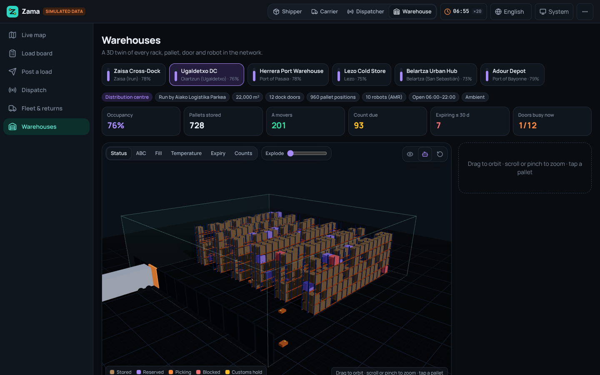
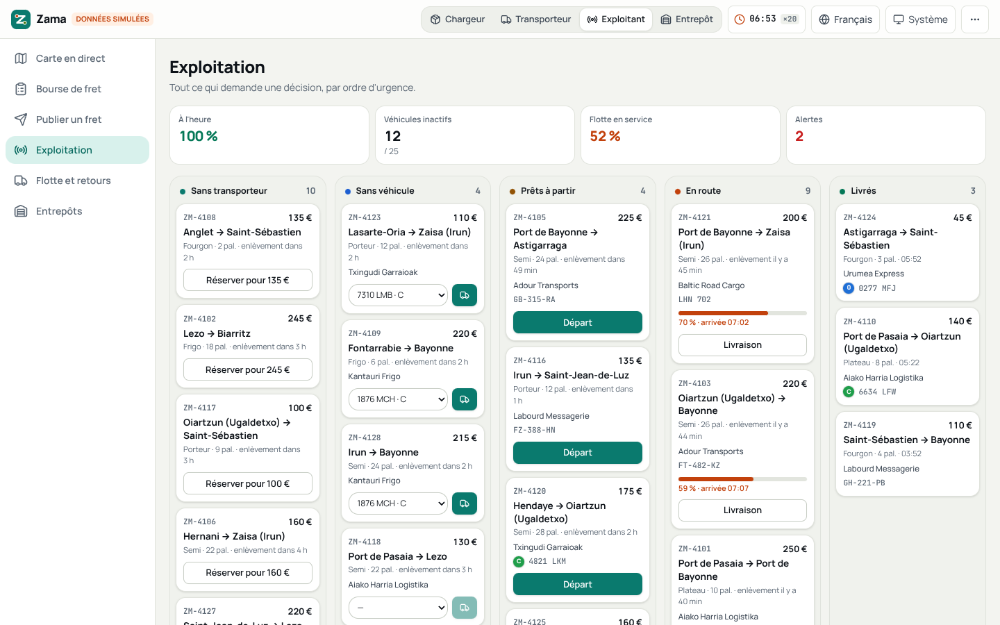
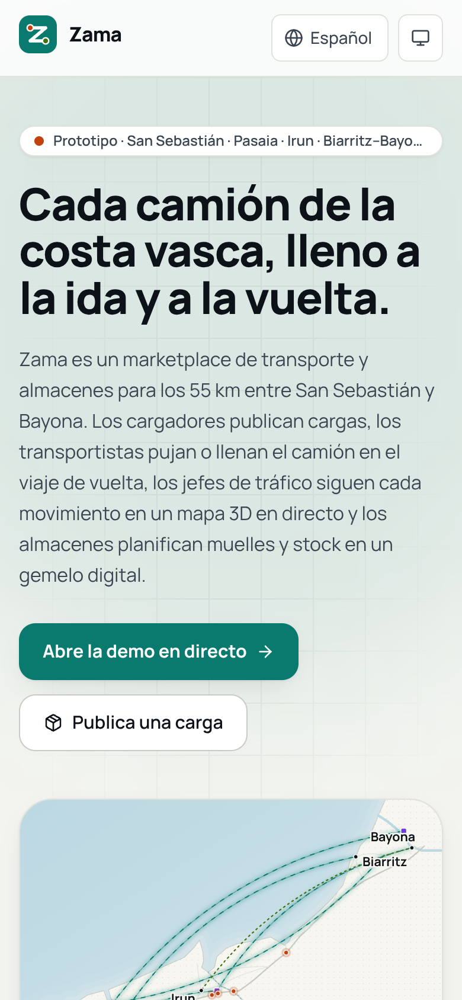
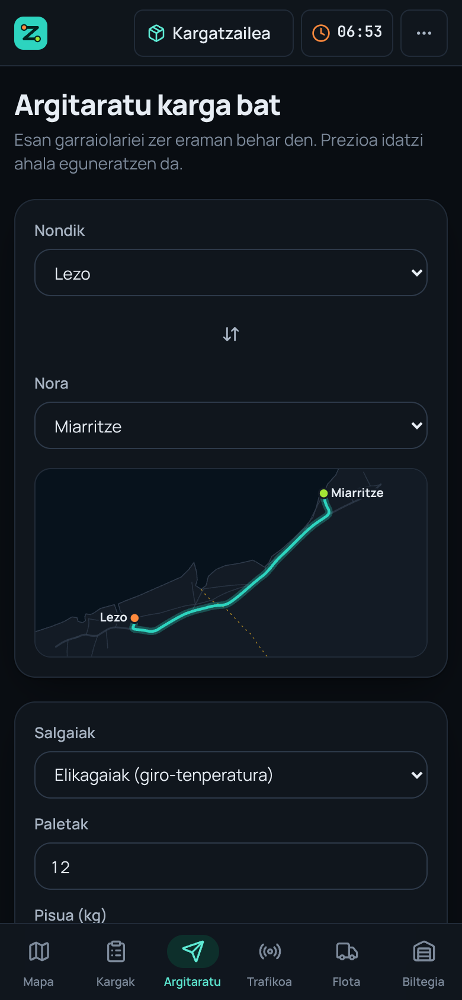
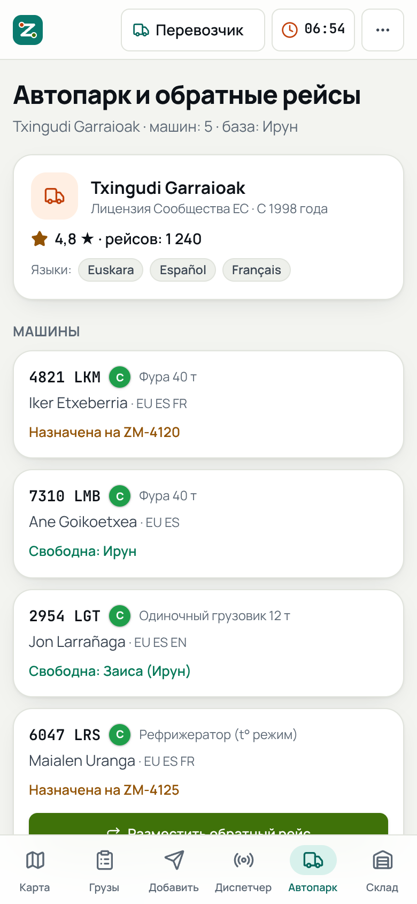

# Zama · freight & warehouse marketplace for the Basque coast

**Every truck on the Basque coast, full both ways.**

**Live demo: [zama-freight.vercel.app](https://zama-freight.vercel.app)** (opens in your language: es · eu · fr · en · ru)

Zama is a working prototype of a freight and warehouse marketplace for the 55 km (by road) cross-border corridor between
**San Sebastián / Donostia**, the **port of Pasaia**, **Irun** (and the Zaisa logistics area), **Hendaye** and the
**Biarritz – Anglet – Bayonne** coast. One market, seen from four seats:

| Role | What they do in Zama |
| --- | --- |
| **Shipper** (*cargador*) | Post a load, get an instant demo price, compare carrier bids, accept one, or book an empty return trip 25–35 % cheaper. |
| **Carrier** (*transportista*) | Bid on loads with a vehicle from their fleet, take instant-price loads, post their empty way home as a return trip. |
| **Dispatcher** (*jefe de tráfico*) | Watch every truck live on a 3D map, assign vehicles, depart and deliver, clear compliance alerts. |
| **Warehouse** (*almacén*) | Run six warehouses as 3D digital twins: stock, slotting, cycle counts, dock-door bookings, cross-dock. |

The UI speaks **Spanish, Basque, French, English and Russian**, has **light and dark** themes, and is built
**mobile-first** (bottom navigation, sheets and touch-friendly 3D on phones).



> **Prototype.** Every company, driver, plate and price is simulated; routes come from a hand-traced road graph and
> are approximate. There is no backend; map tiles are fetched from OpenFreeMap and AWS, and the market runs in the browser.

---

## Screens

| | |
| --- | --- |
|  |  |
| Landing page with the corridor drawn from our own coast outline and road graph. | Live map: trucks with trails, open loads as arcs, return trips, warehouses as columns as tall as they are full.* |
|  |  |
| Load board with route map, price range, bids, return-trip offers, ZBE / cabotage / DeCA checks. | Warehouse digital twin (three.js): racks, pallets coloured by status, AMRs, dock doors with trucks. |
|  | |
| Dispatch board in French: needs a carrier → needs a vehicle → ready → on the road → delivered, with alerts. | |

<p>



</p>

\* The screenshots were taken in a sandbox without access to the vector-tile server, so the map shows its built-in
**schematic fallback** (our coast outline + real relief). In a normal browser the full OpenFreeMap basemap loads
underneath: streets, land use and 3D buildings lit by the sun.

---

## Features

### Marketplace

- **Instant demo price** for every lane and vehicle, shown before anyone bids. It is a demo estimate, not a market rate:
  no market data feeds it, and every price on Post, the load board and the return-trip cards says so. The breakdown
  adds up to the price (`src/lib/pricing.ts`):
  - handling and distance: Zama's hand-calibrated demo model;
  - tolls: the published tariffs by entry, exit and vehicle class (`src/data/tolls.ts`), shown leg by leg with the
    operator and tariff year. The AP-8 uses Bidegi's 2026 tariffs: the free GI-20 ring through Donostia isn't tolled,
    and every entry from the Donostia side (the GI-20, Pasaia, Errenteria) pays Bidegi's "Donostia E" fare. The A-63
    uses ASF's grid of 1 February 2024, the newest per-station grid we could verify. Refresh Bidegi every 1 January
    and ASF every 1 February, and add Gipuzkoa's N-I / A-15 heavy-vehicle charge before routing inland;
  - surcharges, each labelled a demo assumption: cross-border €28 (there is no customs step inside the EU), express
    +25 %, tail-lift +€18, ADR +15 %;
  - a demo range (−12 % / +14 %) and €/km. Empty return trips are priced at 68 % of the instant price, also a demo
    assumption.
- **Two ways to book**: *take bids* (carriers send prices; the shipper accepts) or *instant price* (first carrier to
  accept; *Book now* goes to the best-rated carrier with a truck free for the job, and is off when no carrier may
  legally run it).
- **Bids** with vehicle, driver, DGT eco label, pickup ETA and a note; the carrier sees whether a bid is strong or weak
  against the demo range.
- **Return trips (backhaul)**: carriers post an empty leg (vehicle, from, to, departure, free pallets, discount). Loads
  are matched when pickup is ≤ 15 km from the leg's start, delivery ≤ 18 km from its end, departure within ±6 h and the
  vehicle can carry it. Shippers can post-and-book in one step; carriers can pull a matching load onto their way home.
- **One truck, one job**: a truck on a job or held for a return trip can't be assigned again, and pickers only offer
  free trucks that can carry the load (type and weight). A load booked on a return trip or an accepted bid gets the
  truck it was promised whenever that truck is free.
- **Electronic consignment note** timeline: draft → shipper → carrier (pickup) → consignee (delivery).
- **Live feed** of what the market is doing, and toasts for everything you do.

### Rules checked before booking

Pure functions in `src/lib/checks.ts` and `src/lib/cabotage.ts`, checked against the rules as they stand in October 2026
(see [Sources](#sources-for-the-rules)), each with unit tests in `tests/unit`.

- **San Sebastián / Donostia ZBE** (Ordenanza ZBE Donostia Centro, BOG nº 241 of 16-12-2024, in force from 17-12-2024;
  camera fines since March 2025):
  - labels **0, ECO, C and B** enter freely in phase 1 (art. 8.1 b);
  - **B is banned from phase 2**, which starts 36 months after entry into force (art. 7), on **17-12-2027**.
    donostia.eus says "2028"; Zama uses the ordinance's date, and a B-label truck is told it is allowed until then;
  - vehicles **without a label** are banned (art. 11.1) unless they hold the phase-1 authorisation for regular
    deliveries (art. 8.3, 3.2 f). One demo van has it; another unlabelled van doesn't and gets flagged. From phase 2
    unlabelled delivery vehicles are banned too (art. 11.2);
  - **foreign-plated** trucks have no DGT label at all: they file a declaration and need the city's **prior
    authorisation** (art. 9), which the checks and the dispatch alerts point out;
  - stops are checked against the **annex-1 perimeter** (Parte Vieja, Centro and part of Amara, bounded by the
    Urumea), not the whole city: Gros, Egia and Belartza are outside;
  - Irun has announced its own ZBE, reported for spring 2028. Zama doesn't check it yet.
- **Pays Basque ZFE-m** (since June 2025, 06:00–20:00, Tarnos to Hendaye, which covers every French place in the app):
  Crit'Air 4 or better, and foreign trucks need a Crit'Air sticker. Every demo vehicle passes, so the row is
  informational.
- **Licences and tachographs**: international jobs and cabotage need a **Community licence** for vehicles over 2.5 t,
  and light vans (2.5–3.5 t) on them need a **tachograph** from 1 July 2026. Carriers hold their own country's
  licences (Spanish MDL / MDP, French LTI, or a Community licence issued by Spain, France or Lithuania). The screens
  won't accept, book or assign a carrier or vehicle that may not run the job; `eligibleCarriers(load, ctx)` in
  `src/data/seed.ts` gives the legal pool for a load.
- **EU cabotage** (Reg. 1072/2009 art. 8 as amended by Reg. 2020/1055, Commission Q&A of 21-2-2022), for any carrier
  working **inside a country that isn't its own** (a French haulier on a Spanish domestic job, or an Irun haulier doing
  Hendaye → Bayonne), counted **per vehicle and per host country**:
  - at most **3 operations within 7 days** of the last unloading of an incoming international carriage, with the
    same vehicle;
  - then a **4-day cooling-off** in that country once the vehicle has left it.

  The ledger is derived from the loads in the market plus each vehicle's history before the demo opened
  (`VEHICLE_HISTORY` in `src/data/companies.ts`). Bids show "Cabotage n/3 · this vehicle", accepting, assigning or
  booking over the limit is blocked, and Dispatch lists every vehicle's window and cooling-off. Drivers on cabotage and
  cross-trade jobs are posted, so a posting declaration is flagged. The simulated market's own bids and accepts still
  use a quicker per-carrier count (`cabotageUsed`). Not modelled: the single operation allowed in a third country
  within 3 days of an unladen entry.
- **Transport document**, with who issues it; every load shows which one applies:
  - inside Spain, the **DeCA**: the contracting shipper and the carrier issue it, and it is electronic from
    **5 October 2026** (Ley 9/2025). Cabotage is included. Exempt (flagged): transport needing no licence, house
    removals and parcels;
  - between Spain and France, a **CMR** made out by the sender: on paper, or an **e-CMR if both parties agree**. Both
    countries ratified the e-CMR protocol and neither requires it;
  - inside France, a **lettre de voiture** drawn up by the carrier (arrêté of 9-11-1999), which also shows the plate
    and unloading date on a cabotage leg.

### Live 3D map (`src/components/map`)

- **MapLibre GL 6** with Zama's own light and dark styles on **OpenFreeMap** vector tiles (OpenMapTiles schema):
  3D building extrusions, motorway refs, logistics land tinted violet, place names in the reader's language.
- **Relief** from the Mapzen / AWS Terrain Tiles: hillshade always, optional **3D terrain**.
- **The real sun**: light direction, colour and sky follow the solar position over the corridor for the market clock,
  or for a preset (dawn, morning, midday, golden hour, dusk, night). Presets are sun altitudes, not clock times, so
  "dawn" is dawn in June and in December alike.
- **deck.gl 9.4**, interleaved in MapLibre's WebGL context: `TripsLayer` trucks with trails moving along their routes,
  pulsing truck heads (electric vans in green), `ArcLayer` open loads (teal = bids, blue = instant price), return trips
  in lime, `ColumnLayer` warehouses whose height is their fill, the corridor road graph, and labels.
- Click anything for a card (load progress and arrival, driver and plate, bids, return-trip matches, warehouse fill)
  with links to the load board or the digital twin. Fly-to presets for the corridor (framed so every place fits the
  screen, clear of the floating panels), San Sebastián, Pasaia, the Irun–Hendaye border and Biarritz–Bayonne.
  *Show on map* on the load board opens the map on that load (`?focus=`).
- If the tiles can't be reached (the TileJSON fails, the first tiles all fail, or nothing arrives within 25 s) the map
  switches to a **schematic fallback** drawn from `src/data/coast.ts`, and tries the real basemap again when the browser
  comes back online. A lost WebGL context remounts the map instead of leaving it blank.

### Warehouse digital twin (`src/components/warehouse`, `src/components/screens/warehouse.tsx`)

Six warehouses with fictional operators on the corridor's real logistics sites: the Irun cross-dock (Zaisa area,
bonded rows), Ugaldetxo DC, the Pasaia port warehouse (Herrera quay), Lezo cold store (chilled + frozen), Belartza
urban hub and the Adour depot in the port of Bayonne. Names that borrow a real site say "fictional" in the name.

- **3D twin** with `@react-three/fiber`: instanced pallet positions inside pallet racking (blue uprights, orange
  beams), AMR robots driving the aisles, dock doors with the trucks that are at them right now, temperature and
  customs zones on the floor. **Explode** lifts levels and spreads rows apart.
- **Colour by** status, ABC velocity, fill, temperature, expiry or count status; tap a pallet for its SKU, owner, lot,
  expiry, class, picks per day, last count and walking distance from the dock.
- **Actions**: pick (in the SKU's own unit: cases, cartons, rolls…), cycle count, block / release (a customs hold comes
  back on release), move to the suggested slot (only into an empty position in the same temperature zone). Pick is off
  for blocked and held stock, and a **FEFO** hint points to an earlier-expiring lot of the same SKU.
- **Inventory** search (accent-insensitive, also by owner), a **cycle-count worklist** from the *Count due* tile (A
  every 30 days, B 60, C 120), a **dock-door timeline** with booking, clash detection and **live ETAs** for inbound
  trucks still on the road (late ones flagged), **slotting suggestions** (fast movers far from the doors or up high →
  free low positions near the dock, with metres saved per day), **cross-dock** pairing of inbound and outbound loads,
  and KPIs (occupancy, A movers, counts due, expiring stock, doors busy now).
- Light on phones: capped pixel ratio, smaller shadow maps, shadows redrawn only when something moves, and no drawing
  while the twin is scrolled out of view.

### Everything else

- **Five languages** with locale-aware money, numbers, units and relative times (`Intl`), plurals, hreflang and a
  remembered choice (cookie read by `src/proxy.ts`). Places use the names people use in each language
  (Donostia / San Sebastián / Saint-Sébastien / Сан-Себастьян, Baiona / Bayona / Bayonne / Байонна…).
- **Light and dark themes** (system, light, dark) without a flash on load; the map, the twin and the share cards each
  have their own palettes. Text and buttons meet 4.5:1 contrast in both.
- **Accessible on touch and keyboard**: 40 px touch targets on phones, sheets that keep focus inside and hand it back
  when they close, labelled icon buttons in every language.
- **Share cards**: a custom 1200×630 Open Graph image per language with alt text in that language, rendered with
  `next/og` on the first request and cached.
- **App icon, web manifest, robots and sitemap**; the demo app itself is `noindex`.

---

## How the simulation works

The market is seeded relative to the moment you open the demo (`src/data/seed.ts`), so trucks are already on the road
and pickups are always a few hours away. A **simulated clock** runs at ×20 by default (click the clock for ×1 or ×60),
and a director (`src/store/director.ts`) keeps the market alive: carriers bid on loads they have a truck for, other
shippers accept the best bid as pickup nears, booked loads get vehicles (one job per truck), trucks depart and arrive,
new loads appear, unbooked ones get a later pickup or expire, carriers post their empty legs home and shippers fill
them, and the dock schedule rolls forward. It runs on simulated time (rates per simulated minute, in steps of at most
five minutes), so a background tab that the browser throttles to one tick a minute sees the same market, and it keeps
at least six trucks on the road. After more than six simulated hours without a tick (a sleeping laptop, a frozen tab)
the day is re-seeded around the current time.

What you create yourself (loads you post, your bids, return trips, dock bookings, warehouse changes, role and map
settings) is saved in your browser (`localStorage`, key `zama-demo-v1`, schema version 2, see `src/store/saved.ts`)
together with the market clock, so a reload carries on where you left off: a truck that was halfway is still halfway.
Saved records are checked against the catalogues when the demo opens, and any that don't fit are dropped. *Reset demo*
in the ⋯ menu clears it.

---

## Tech stack

| | |
| --- | --- |
| Framework | Next.js 16 (App Router, Turbopack, `proxy.ts`), React 19, TypeScript |
| Styling | Tailwind CSS 4, design tokens in `src/app/globals.css`, Manrope + JetBrains Mono (`next/font`) |
| State | zustand 5 |
| Map | MapLibre GL JS 6.15, deck.gl 9.4 (`@deck.gl/maplibre` interleaved overlay) |
| 3D twin | three.js 0.186, @react-three/fiber 9, @react-three/drei 10 |
| Share cards | `next/og` (satori) with WOFF fonts from `assets/fonts` |

```
src/
  app/[lang]/            pages per language: landing, app/{map, loads, post, dispatch, fleet, warehouse}, OG image
  components/            app shell, UI kit, map (style + deck layers), warehouse twin, screens
  data/                  places, road graph & routing, coast outline, companies, warehouses & bins, seeded market
  i18n/                  locales, dictionaries (en is the source; the others are type-checked against it)
  lib/                   pricing, compliance checks, solar position, geodesy, formatting
  store/                 the market store (actions), the director (simulation), saved state and the shared clock
  proxy.ts               sends / and any un-prefixed path to the reader's language
scripts/                 copy-worker.mjs (MapLibre worker → public/vendor), screens.mjs (README screenshots)
```

Notes:

- MapLibre 6 loads its web worker from a URL next to its own module, which a bundler can't follow, so
  `scripts/copy-worker.mjs` copies it to `public/vendor/` (run automatically on install, `dev` and `build`).
- Data-driven screens render on the client after the market opens, so server HTML never disagrees with the simulated
  clock.

---

## Run it

```bash
npm install          # also copies the MapLibre worker into public/vendor
npm run dev          # http://localhost:3000 → redirects to your language
npm run build && npm start
npm run check        # eslint + next typegen + tsc
```

Screenshots for this README:

```bash
npm run build && npm start &
npx playwright install chromium   # once
npm run screens                   # writes docs/screens/*.png (BASE=… to point elsewhere)
```

## Deploy

Deployed on Vercel from `main` (every push redeploys): framework preset **Next.js**, no environment variables required. Optional: `NEXT_PUBLIC_SITE_URL` to force the
canonical origin used in Open Graph tags, hreflang and the sitemap (otherwise Vercel's production URL is used).

---

## Assumptions

- **"Bari's area"** in the brief is read as **Biarritz–Anglet–Bayonne** ("BAB"), the French end of the corridor.
  Changing it is a matter of the places in `src/data/places.ts`.
- **Zama** is a working name.
- The first service area is the Basque border corridor; the expansion path in the copy is Bilbao, Vitoria-Gasteiz,
  Pamplona and Bordeaux.

## Limitations (it's a prototype)

- No backend, accounts, payments or real carriers: the market is simulated in each browser.
- Routing uses a hand-traced graph of the AP-8, the GI-20 ring, the A-63, N-1/GI-636, D-810 and urban links (Dijkstra on travel time),
  not a routing engine; times and distances are close at regional scale, approximate street by street.
- Prices and CO₂ are a demo model; only the tolls follow published tariffs. CO₂ is per vehicle-km, tank-to-wheel,
  charged to one load (ISO 14083 / GLEC would use well-to-wheel figures shared by tonne-km). The rules are simplified
  to what a dispatcher needs to see: no one-off ZBE authorisations, no third-country cabotage after an unladen entry,
  no registry check of licences.
- The e-CMR / DeCA flow is a status timeline, not an integration with a certified provider.

## What the research says comes next

A review of current freight exchanges (TIMOCOM, Trans.eu, Wtransnet, Teleroute / Alpega, Transporeon, Ontruck) and of
warehouse software (Blue Yonder, SAP EWM, Infor, Gartner's 2025 WMS Magic Quadrant) against this prototype.

**Marketplace quick wins**, each small on top of what is here:

- A shareable **live tracking link** for the consignee: every load already has its route, progress and ETA.
- **Ratings after delivery**, asked of both sides (carrier stars are static demo numbers today).
- **Verified-company badges**: licence, insurance, registry check.
- **Payment guarantee** and *get paid in 48 h* (Wtransnet and Teleroute run these with Coface), plus a shipper
  **payment-reliability score** and payment terms on each load (Trans.eu's TransRisk).
- **Dock slots booked by the carrier** from a booked load, re-planned from the live ETA (Trans.eu Dock Scheduler,
  Transporeon time slots).
- **Saved searches** with an alert when a matching load is posted.

Bigger steps: tenders and contract lanes, messaging and digital deal confirmation per load, AI freight input (paste an
email, get a filled load), a data-backed price index, and on-demand warehouse space (pallet-weeks) so shippers can book
storage as well as trucks.

**Warehouse capabilities**, where the prototype stands:

| Capability | In Zama today | Next step |
| --- | --- | --- |
| AI / dynamic slotting | Rule-based moves with an *Apply* button | Continuous re-slotting from demand forecasts, SKU affinity and the labour cost of each move |
| Robots (AMR) | Animated in the twin | An orchestration layer between the WMS and mixed fleets (VDA 5050) |
| Digital twin | Live 3D replica with colour modes | What-if runs on layout, robot count and staffing |
| Dock & yard | Door timeline, clash detection, live ETAs | Carrier self-booking tied to loads; gate check-in and yard moves |
| Labour management | — | Engineered standards vs. actuals, headcount per shift from volume |
| Cycle counting | ABC worklist and manual counts | Simulated drone or vision scans with discrepancy flags |
| Cold chain | Temperature zones and a colour mode | Sensor time series, excursion alarms and automatic quarantine (EU GDP) |
| FEFO / lots | Lots, expiries, FEFO hint | FEFO allocation, minimum shelf life per customer, recall trace |
| Picking | Pick per position | Mobile pick paths with next-location prompts; voice or vision picking |
| Carbon | CO₂e per trip | ISO 14083 / GLEC well-to-wheel figures, hub emissions (the method CountEmissionsEU sets for published figures) |
| Cross-docking | Inbound/outbound pairing, 45 min handling | ASNs, door pairing and dwell timers |

## Roadmap

1. Backend (Postgres + realtime) with accounts, verified companies (licence, insurance, registry) and per-vehicle
   cabotage history.
2. The marketplace quick wins above.
3. A routing engine (Valhalla or OSRM) with HGV profiles, plaza tolls, Gipuzkoa's N-I / A-15 HGV charge and live
   traffic.
4. A certified DeCA / e-CMR / electronic lettre de voiture provider; payments with escrow or factoring.
5. Telematics for live positions and arrival times; EV charging for vans in the ZBE.
6. More checks: Spain's ban on drivers of vehicles over 7.5 t loading or unloading (since September 2022), and the
   tachograph's generation (vans over 2.5 t abroad need the smart tachograph v2; Zama only checks that one is fitted).
7. Expand along the corridor: Bilbao, Vitoria-Gasteiz, Pamplona, Bordeaux.

## Sources for the rules

- DeCA: [Ministerio de Transportes](https://www.transportes.gob.es/transporte-terrestre/profesionales-transporte/servicios-transportista/documento-electronico-control-administrativo-deca)
  (Ley 9/2025, disposición transitoria octava; [resolution of 5-6-2026](https://www.boe.es/buscar/act.php?id=BOE-A-2026-12784);
  [Orden FOM/2861/2012](https://www.boe.es/buscar/act.php?id=BOE-A-2013-154) arts. 2, 4 and 7).
- Lettre de voiture: arrêté of 9-11-1999 on the documents carried on board, art. 4.
- Donostia ZBE: the [ordinance, BOG nº 241 of 16-12-2024](https://egoitza.gipuzkoa.eus/gao-bog/castell/bog/2024/12/16/c2409185.pdf)
  (arts. 7, 8, 9, 11 and annex 1); foreign vehicles: [donostia.eus](https://donostia.eus/en/movilidad/zona-bajas-emisiones/solicita-autorizacion/foreing-vehicles),
  [RACE map](https://www.race.es/zonas-de-bajas-emisiones/mapa-zbe-donostia-san-sebastian).
- Pays Basque ZFE-m: [Connexion France](https://www.connexionfrance.com/news/zfe-basque-country-to-ban-most-polluting-vehicles-from-june-2025/707597);
  ZFEs kept by the Conseil constitutionnel on 21 May 2026 ([Public Sénat](https://www.publicsenat.fr/actualites/politique/loi-de-simplification-le-conseil-constitutionnel-censure-la-suppression-des-zfe-et-lassouplissement-du-zan)).
- Cabotage (Reg. 1072/2009 as amended by Reg. 2020/1055): [EUR-Lex summary](https://eur-lex.europa.eu/summary/EN/tr0038),
  [Commission Q&A](https://transport.ec.europa.eu/transport-modes/road/mobility-package-i/market-rules/rules-cabotage-applicable-21-february-2022_en)
  (Q4, Q7, Q8, Q10); posting: [Q&A on Directive 2020/1057](https://transport.ec.europa.eu/transport-modes/road/mobility-package-i/posting-rules/questions-and-answers-posting-drivers-under-directive-eu-20201057_en).
- Licences and light vans: [TRACE II guidance](https://transport.ec.europa.eu/system/files/2023-12/TRACE_II_Access_to_Profession_Enforcement_Guidance.pdf),
  [tachograph Q&A](https://transport.ec.europa.eu/transport-modes/road/mobility-package-i/tachographs/questions-and-answers-tachograph-provisions-mobility-package-1_en).
- e-CMR is optional: [UN Treaty Collection](https://treaties.un.org/Pages/ViewDetails.aspx?src=TREATY&mtdsg_no=XI-B-11-b&chapter=11&clang=_en)
  (Spain and France are parties), [eFTI / e-CMR overview](https://routal.com/en/ecmr).
- Tolls: [Bidegi 2026 AP-8 tariffs](https://www.bidegi.eus/documents/42696171/0/2026__AP-8_AP-1_AP-636_tarifak.pdf/0c9dbcf3-f3e7-e6f6-709b-8cbb7d9da9d5),
  [ASF class 4 grid, 2024](https://public-content.vinci-autoroutes.com/PDF/Tarifs-peage-asf/C4-TARIFS-WEB-2024.pdf),
  [Bidegi discounts](https://www.bidegi.eus/en/deskontuak).

These were checked through web search in October 2026; the primary texts (BOE, the Donostia ordinance) should be read
before relying on any of it.

---

## Data & credits

- Map data © [OpenStreetMap](https://www.openstreetmap.org/copyright) contributors, tiles by
  [OpenFreeMap](https://openfreemap.org), schema by [OpenMapTiles](https://openmaptiles.org).
- Terrain: [Mapzen Terrain Tiles](https://github.com/tilezen/joerd/blob/master/docs/attribution.md) on AWS Open Data.
- Fonts: Manrope and JetBrains Mono, SIL Open Font License 1.1 (`assets/fonts/OFL.txt`).
- The coast outline, road graph, companies, people and plates were drawn or invented for this prototype. Plates use a
  `DEMO-` format, and the invented names were web-checked against real businesses
  ([docs/fictional-names.md](docs/fictional-names.md)); formal registry checks are still pending.
